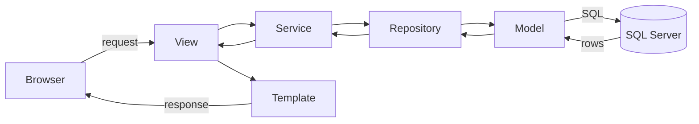

# SkillBridge Employee Management System

A Django web application for managing employee information, backed by SQL Server.

## Table of Contents

- [Project Introduction](#project-introduction)
- [Problem Statement](#problem-statement)
- [Requirements](#requirements)
  - [Functional Requirements](#functional-requirements)
  - [Non-functional Requirements](#non-functional-requirements)
- [Main Application Features](#main-application-features)
- [Architecture (MVT)](#architecture-mvt)
- [Data Model](#data-model)
- [Data-storage Approach](#data-storage-approach)
- [State-management Approach](#state-management-approach)
- [Delivery Plan](#delivery-plan)
- [Testing Approach](#testing-approach)
- [Security Considerations](#security-considerations)

## Project Introduction

The **Employee Management System** is a web application that allows for the management of all employee information. It allows authorised users to view and edit all employee information. It should have a feature to add additional functionality, such as employee skills and training records, which could be added in the future.

## Problem Statement

Many organisations still keep employee records in spreadsheets, paper files or disconnected tools. This makes the information hard to search, easy to duplicate or get wrong, and difficult to protect, because anyone with the file can see or change everything, including sensitive details such as salary. There is also no reliable record of who changed what.

The SkillBridge Employee Management System solves this by keeping all employee records in one secure, central web application. Authorised users can quickly find, view, add, edit and delete employees, and every entry is validated before it is saved. Access is controlled by login and role, so each person sees and does only what their role allows. The system is also designed so that new features, such as employee skills and training records, can be added later without redesigning it.

## Requirements

### Functional Requirements

| ID | Requirement |
|---|---|
| FR1 | The system must allow authorised users to view a list of employees. |
| FR2 | The system must allow users to search for employees. |
| FR3 | The system must allow users to filter employee information where necessary. |
| FR4 | The system must allow users to view the details of an employee. |
| FR5 | The system must allow authorised users to add a new employee. |
| FR6 | The system must allow authorised users to edit an existing employee. |
| FR7 | The system must allow authorised users to delete an employee. |
| FR8 | The system must validate employee information before saving it. |
| FR9 | The system must give appropriate feedback when an operation succeeds or fails. |
| FR10 | The system must require users to log in and restrict functionality by role (authentication and authorisation). |
| FR11 | The system must provide a focused REST-style Web API for employee data. |

### Non-functional Requirements

- **Security:** Passwords are encrypted, pages are restricted by role, and input is validated and protected against common attacks (e.g. CSRF, SQL injection, XSS).
- **Performance:** Pages load in under 3 seconds, supported by a caching strategy.
- **Availability:** The system is available 99% of the time and can be hosted and deployed to a live environment.
- **Reliability:** The system handles errors gracefully, does not crash during normal use, and logs errors for troubleshooting.
- **Usability:** The interface is consistent, responsive across devices and easy to use, with clear feedback. A user should be able to add an employee in under 2 minutes.

## Main Application Features

- **Employee management (CRUD):** list, view details, add, edit and delete employees.
- **Search and filtering:** find employees by keyword and filter by relevant fields.
- **Validation and feedback:** server-side and client-side validation, plus success and error messages.
- **Authentication and authorisation:** login and role-based access to restricted functions.
- **MVT architecture:** Models, Views and Templates, with business logic separated into a services layer.
- **Middleware:** for cross-cutting concerns such as security, logging and error handling.
- **Django ORM with SQL Server:** persistent storage through the mssql-django backend.
- **Reusable templates:** template includes or custom template tags, with consistent layouts and styling.
- **Client-side functionality and responsive design:** JavaScript interactivity that works on desktop and mobile.
- **State management and caching:** sessions and a caching strategy for better performance.
- **Two-way server-to-client communication:** real-time updates (e.g. WebSockets) so changes appear without a page refresh.
- **REST-style Web API:** a focused API for employee data.
- **Security controls:** CSRF protection, secure password handling, input sanitisation and restricted routes.
- **Testing, logging and troubleshooting:** unit and functional tests, plus logging for diagnosing problems.
- **Production build and deployment:** compiled or optimised assets and hosting on a live environment.

## Architecture (MVT)

The application follows Django's Model-View-Template pattern, with two extra layers between the view and the database. Views call the service layer, the service layer calls the repository layer, and only the repository layer uses the ORM to turn Python code into SQL.

| Layer | Responsibility |
|---|---|
| **Template** | HTML pages that the user sees |
| **View** | Receives the request, checks permissions, returns a response |
| **Service** | Business logic and rules |
| **Repository** | The only layer that talks to the database through the ORM |
| **Model** | Python classes that become database tables |

## Data Model

| Field | Type | Why |
|---|---|---|
| `first_name` | Text (max 50) | Employee's first name |
| `last_name` | Text (max 50) | Employee's last name |
| `employee_id` | Text (max 20), unique | Identifies the employee |
| `phone_number` | Text (max 20) | Employee's contact information |
| `email` | Email, unique | Employee's contact information |
| `hire_date` | Date | When the employee started at the company |
| `employment_type` | Choice (full-time, part-time, contract) | Type of employment |
| `salary` | Decimal (10 digits, 2 decimal places) | Employee salary |
| `status` | Choice (active, on leave, terminated) | Employment status |
| `is_active` | Boolean | Whether the employee is currently active in the company |
| `department` | Foreign key to `Department` | Department the employee belongs to |
| `created_at` / `updated_at` | Date and time | When the record was created and last changed |

The `Department` table holds a unique `name`.

## Data-storage Approach

The system uses SQL Server, managed through SQL Server Management Studio, to store all the data it needs. Data is kept in tables made up of rows and columns, which Django creates from the models through migrations. Every record is identified by a primary key, related tables are linked by foreign keys, and constraints protect the integrity of the data. The system stores all employee information (such as name, surname and active status), user accounts and session data. The design also allows future tables to be added and linked to the Employee table.

Django communicates with the database through Object-Relational Mapping (ORM) and the mssql-django backend. The connection details are set in the `DATABASES` section of the settings. The system accesses data through the layered structure of the MVT architecture: views call the service layer, the service layer calls the repository layer, and only the repository layer uses the ORM to turn Python code into SQL.

## State-management Approach

The Employee Management System remembers who the user is and what they are allowed to do while they are using the system. Once a user logs in, Django creates a session with the session ID stored in a secure cookie and the session data held on the server. This keeps the user logged in, identifies their role so that restricted pages and actions are protected, and supplies the CSRF token needed for secure form submission.

- The system remembers the user's most recent search and filter settings, so they remain as the user moves between pages.
- Frequently requested data is cached to improve performance, and the cache is cleared whenever an employee is added, edited or deleted.
- For logging, the application records successful and failed login attempts and logouts, and keeps a record of who edited, deleted or added employee information.
- To track user activity, the application stores each user's login time, logout time and last activity time so that an accurate report can be generated.
- It also records the IP address and browser details for security tracking.

Django's login and logout signals can be used to save this information to an audit or session log model.

## Delivery Plan

### Development Tasks

- [ ] Set up the Django project (virtual environment, config project, employees app)
- [ ] Configure the SQL Server database connection and run the first migration
- [ ] Create the models and migrations
- [ ] Create the repository layer (the only ORM access)
- [ ] Create the service layer (business logic and rules)
- [ ] Build the CRUD views, forms and URLs
- [ ] Create templates: base layout, reusable includes, static files
- [ ] Add authentication and authorisation (login, logout, roles)
- [ ] Enable CSRF protection and other security settings
- [ ] Build the REST API
- [ ] Add caching, sessions and real-time updates
- [ ] Test: unit testing, component testing (each function and class), then system testing (the whole workflow)
- [ ] Deploy the system

## Testing Approach

- **Unit testing:** Test individual pieces in isolation, such as model validators (future hire date, phone number format, non-negative salary) and form validation methods.
- **Component testing:** Test that the Employee Repository can add, get, update, delete and search employees.
- **System testing:** Log in, search, add, edit and delete an employee, then log out.

## Security Considerations

The application, its users and its data are protected in several layers.

- **Access control:** Access is controlled through authentication and role-based authorisation. Every page requires a login, and permissions limit what each role can do. For example, only administrators can delete employees, while viewers have read-only access.
- **Passwords:** Passwords are never stored in plain text. Django hashes them with PBKDF2, and password validators enforce strong passwords.
- **CSRF:** Forms are protected against cross-site request forgery by Django's CSRF middleware and a token in every form.
- **SQL injection:** Prevented because all database access goes through the ORM's parameterised queries, with no raw SQL built from user input.
- **XSS:** Django's template auto-escaping, together with server-side input validation, protects against cross-site scripting.
- **Sessions:** Sessions are secured with Secure and HttpOnly cookies and a timeout for idle users. Logging out clears the session.
- **Production settings:** HTTPS will be enforced to protect data in transit, `DEBUG` will be set to `False`, `ALLOWED_HOSTS` will be configured, and custom error pages will avoid leaking technical details.
- **Secrets:** The `SECRET_KEY` and database credentials are kept in environment variables rather than in the code or version control, and the application connects to SQL Server with a least-privilege account.
- **Other protections:** Django's security middleware adds further protection against clickjacking and content-type sniffing. API endpoints will require authentication and use throttling and validation, and an audit log of logins and employee changes will provide accountability.
